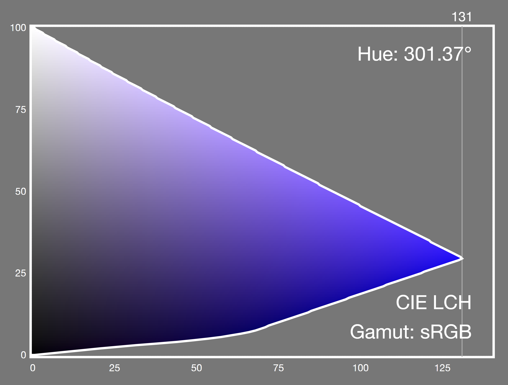
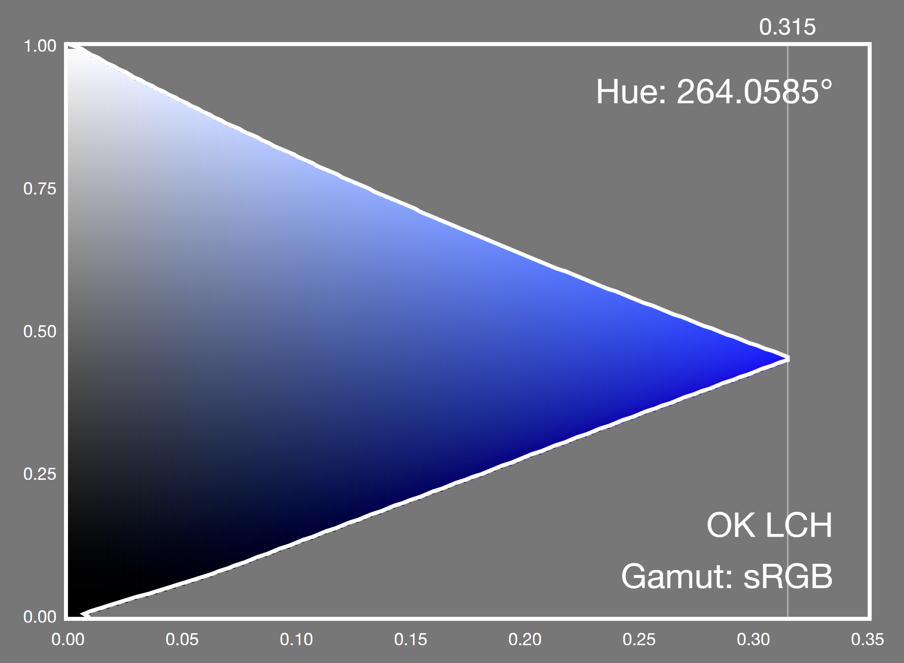

import { Aside, Button, Steps } from 'astro-pure/user'
import LinkPreview from '@/components/content/LinkPreview.astro'
import ColorRamp from './ColorRamp.astro'
import SrgbPerception from './SrgbPerception.astro'

起源于犀牛鸟的任务：

> TDesign 各技术栈站点底部都有主题生成器挂件。输入一个主色后，它会扩展出一整套连续色阶，承载从最浅背景、Hover 高亮到最深文字强调等不同场景。
>
> 请使用 TypeScript 提供一个函数：输入任意主色，自动“变出”一套 10 级、由浅到深、过渡自然的完整主色阶，并提供 HTML 或任意形式的 UI 界面供体验。如果你能同时考虑深色模式下的色阶效果，以及生成与主题色相关联的中性色阶，将是更好的实现。

其实我在此之前就对颜色相关的一些工作比较感兴趣，所以也想更深入地去了解，想了解这些颜色为什么这样排列，极端输入下应该如何取舍，以及一条色阶怎样继续长成主题。

项目的在线体验和文档都在这里：

<LinkPreview href='https://okramp.seeridia.top' />

<LinkPreview href='https://github.com/seeridia/okramp' />

## 背景

最初看到这个需求时，我也把它理解成一个最普通的插值问题：给定主色，再找一个浅色和一个深色，在它们之间取十个点。

实现并不困难。真正困难的是，当这些颜色摆在一起时，它们是否连续、美观。

哪该如何插值呢

为了把差异直接摆出来，我用同一个主色 `#0052D9` 做了一组最简单的实验：前七阶从白色插值到主色，后三阶再从主色插值到黑色。除了颜色空间不同，其余条件完全相同。

### sRGB 与 HSL

<ColorRamp
  title='sRGB 通道线性插值'
  seed='#0052D9'
  colors={[
    '#ffffff',
    '#d5e2f9',
    '#aac5f2',
    '#80a9ec',
    '#558ce6',
    '#2a6fdf',
    '#0052d9',
    '#003791',
    '#001b48',
    '#000000'
  ]}
/>

就拿我们更常见的 sRGB 来插值，直接让红、绿、蓝三个通道线性变化。色值很好计算，但通道走过相同距离，不代表人眼感受到的明度也走过相同距离。所以你也能明显能感受到他们的亮度并不均匀。

下面这个图就比较直观了

这里其实有两层的不对等。

第一层发生在屏幕上。sRGB 保存的通道值经过一条近似 Gamma 的传递函数编码，它不是灯珠发光强度的直接刻度。

<SrgbPerception />

这两组颜色是两种不同的中点定义。`#808080` 的三个通道都位于 `00` 和 `FF` 的数值中点；但将 sRGB 编码还原成线性光后，它的相对亮度只有约 21.6%。真正具有 50% 线性光亮度的灰色接近 `#BCBCBC`。

这说明 **sRGB 数值中点不等于视觉中点**。但 50% 的视觉中点也不等于 50% 的感知明度：眼睛对亮度的响应同样是非线性的，因此 `#BCBCBC` 看起来会明显偏亮，`#808080` 反而更接近通常所说的视觉中灰。第一层不对等发生在 sRGB 编码与屏幕实际发光强度之间，至于人最终觉得它有多亮，还需要继续考虑视觉系统。

第二层发生在眼睛与大脑里。人眼没有三种分别读取屏幕 R、G、B 数字的传感器。视网膜中 S、M、L 三类视锥细胞各自覆盖一段相互重叠的光谱；单个视锥只能报告自己吸收了多少光子，颜色需要由三类视锥的相对响应推断。

因此，sRGB 中每个通道等量前进，只保证设备编码坐标里的步长相等。转换到人眼使用的明暗与拮抗信号后，每一步的距离会被不同程度地拉伸或压缩。

不过，sRGB 编码本身**部分利用了视觉的非线性**，因此它比直接保存线性光更适合有限位深的图像编码；但它仍然不是三维的感知均匀颜色空间。W3C 对它的描述很直接：sRGB 既不是线性光空间，也不是感知均匀空间。若目标是物理正确地混合光，应在线性 sRGB 中插值；若目标是让颜色沿途更接近感知等距，则更适合使用 [Oklab 或 OKLCH](https://www.w3.org/TR/css-color-4/#interpolation-space)。

<ColorRamp
  title='HSL 插值'
  seed='#0052D9'
  colors={[
    '#ffffff',
    '#e3e6eb',
    '#becade',
    '#91adda',
    '#5c8dde',
    '#1f6ceb',
    '#0052d9',
    '#183d79',
    '#182130',
    '#000000'
  ]}
/>

这边就稍微简单讲讲，HSL 把色相、饱和度和亮度分开了，控制起来比 RGB 直观。简单来说，它把颜色参数变得更容易理解（而不是对着 RGB 三个值去调整），却没有让颜色之间的距离更符合人眼感受。

甚至本质上来说，HSL 只是把 sRGB 立方体重新表示成圆柱坐标，本质没有区别。它没有根据视觉实验重新校准空间，因此在圆柱中相同长度的路径，不代表相同的感知色差。

### CIELAB 插值

<ColorRamp
  title='CIELAB 插值'
  seed='#0052D9'
  colors={[
    '#ffffff',
    '#e0e0fa',
    '#c1c1f4',
    '#a1a4ee',
    '#7e87e7',
    '#556ce0',
    '#0052d9',
    '#1c378b',
    '#181f45',
    '#000000'
  ]}
/>

到 CIELAB，目标才从“方便描述颜色”变成了“让数值距离近似人眼感受到的色差”。它用 $L^*$ 描述感知明度，用 $a^*$ 表示红—绿方向，用 $b^*$ 表示黄—蓝方向。在这个空间中走过相同距离，通常比 RGB 和 HSL 更接近相同的视觉变化。

上面的过渡因此平稳了不少，尤其是浅色到主色这一段。不过，CIELAB 的感知均匀性只是一种近似，因为它假设整套颜色空间可以共用一把固定的欧氏距离：

$$
\Delta E_{76}^{*}
=
\sqrt{(\Delta L^{*})^{2}+(\Delta a^{*})^{2}+(\Delta b^{*})^{2}}
$$

但视觉实验发现，人眼的“最小可觉差”会随颜色位置变化。它在色彩空间中表现为大小、方向不同的椭圆，而不是处处相同的圆：

- 某些区域很小的数值变化就能被察觉。
- 某些区域需要更大的变化才能被察觉。
- 蓝色区域还存在明显的色相与彩度耦合。
- 高彩度颜色距离中性轴更远，更容易暴露模型偏差。

也就是说，人眼在有些区域更敏感，在另一些区域更迟钝；一个固定的欧氏距离无法同时贴合所有区域。这与视锥细胞和后续拮抗通道的非线性响应有关，亮度、彩度和周围环境还会继续影响最终感受到的色差。

当然，后来的 CIEDE2000 色差公式因此加入了随明度、彩度和色相变化的权重，并专门增加蓝色区域的旋转修正项。但这些本质上都是拟补的一些手动，换句话说，如果 CIELAB 本身处处均匀，这些修正就没有存在的必要。[原始论文](https://hajim.rochester.edu/ece/sites/gsharma/papers/cic04ciede2000.pdf)

下面举一个比较明显的例子：在 CIELCH 中保持数值色相不变，只增加彩度



_CIELCH：固定数值色相为 301.37°。图片来源：[W3C CSS Color 4](https://www.w3.org/TR/css-color-4/#hue-curvature)_



_OKLCH：固定数值色相为 264.0585°。图片来源：[W3C CSS Color 4](https://www.w3.org/TR/css-color-4/#hue-curvature)_

这两张图可以这样看：纵轴是明度，越向上越亮；横轴是彩度，越向右越鲜艳。灰色区域超出了 sRGB 能显示的范围，白色轮廓内则是屏幕能够呈现的颜色。

两张图分别固定了 CIELCH 与 OKLCH 中对应 sRGB 蓝色的色相，所以观察时**比较彩色区域从左向右是否始终像同一种蓝色**。

先看第一张 CIELCH 图。在相近明度下横向移动，只增加彩度，**左侧和中段明显偏紫，接近最右端时才逐渐变成蓝色**。计算中的色相角始终是 301.37°，人眼看到的色相却发生了变化，这正是 hue curvature。

再看第二张 OKLCH 图。用同样方式从左向右观察，颜色主要是从灰蓝逐渐变成鲜蓝，视觉色相基本保持稳定。

这个对照说明，CIELAB 的问题是它的“固定数值色相”没有对应到人眼感受到的固定色相。

所以回过头来看看

<ColorRamp
  title='CIELAB 插值'
  seed='#0052D9'
  colors={[
    '#ffffff',
    '#e0e0fa',
    '#c1c1f4',
    '#a1a4ee',
    '#7e87e7',
    '#556ce0',
    '#0052d9',
    '#1c378b',
    '#181f45',
    '#000000'
  ]}
/>

你能很明显的发现，浅色部分的蓝色偏紫。它们都是在 CIELAB 中保持数值色相不变，但人眼感受到的色相却发生了变化。

## 为什么是 OKLCH（OKLAB）

回头看前面的几种方案，它们其实各自解决了一部分问题。

sRGB 忠实描述设备，却不适合拿通道数值当作视觉距离；HSL 让参数变得容易理解，却没有改变 sRGB 不均匀的底层；CIELAB 开始认真拟合人的感知，但在蓝色、高彩度和色相线性上仍有明显偏差。

我需要的颜色空间至少要做到三件事：明度变化看起来稳定，改变彩度时尽量不带动色相，计算过程还要足够简单，才能在浏览器里实时生成整套主题。Oklab 正好是围绕这些目标设计的。

### 基于视觉实验数据得到的色彩空间

Oklab 沿用了 IPT 颜色空间简洁的计算结构。颜色先从 XYZ 转换成近似三类视锥响应的 $l$、$m$、$s$，再经过立方根形式的非线性压缩，最后组合成一条明度轴和两条拮抗色轴：

$$
\begin{pmatrix}
l \\
m \\
s
\end{pmatrix}
=
\mathbf{M}_{1}
\begin{pmatrix}
X \\
Y \\
Z
\end{pmatrix}
$$

$$
\begin{pmatrix}
L \\
a \\
b
\end{pmatrix}
=
\mathbf{M}_{2}
\begin{pmatrix}
\sqrt[3]{l} \\
\sqrt[3]{m} \\
\sqrt[3]{s}
\end{pmatrix}
$$

真正重要的是矩阵 $\mathbf{M}_{1}$ 与 $\mathbf{M}_{2}$ 如何确定。Oklab 的作者 Björn Ottosson 准备了三组用于检验明度、彩度和色相的数据：明度与彩度数据由 CAM16 在正常观看条件下生成，等色相数据则来自用于建立 IPT 的视觉实验。随后调整矩阵参数，使模型尽可能把“同样亮”“同样鲜艳”和“同一色相”的颜色分别放在对应的等值线上。[Oklab 的推导过程](https://bottosson.github.io/posts/oklab/#how-oklab-was-derived)

<Aside type='note' title='IPT 与 CAM16 是什么？'>

可以把 **IPT** 理解成一套轻量的颜色坐标。它把颜色拆成“有多亮”，以及“偏红还是偏绿”“偏蓝还是偏黄”。它计算简单，而且改变颜色深浅时不容易突然跑色；不足之处是，它判断一个颜色有多亮、多鲜艳时还不够准确。

**CAM16** 更像一台复杂的视觉模拟器。同一个色值放在明亮房间、昏暗房间或不同背景上，看起来可能并不一样；CAM16 会把这些观看条件也考虑进去，再估计人眼觉得它有多亮、多鲜艳。它更全面，但计算也复杂得多。

Oklab 的做法可以概括为：**使用 IPT 简单好算的结构，学习 CAM16 对明度和彩度的判断，再用视觉实验校准色相。** 最终得到一套接近复杂视觉模型，同时能在浏览器里快速计算的颜色坐标。

</Aside>

因此 Oklab 针对图像处理与颜色混合的需求，在准确度、稳定性和计算复杂度之间取得了更合适的平衡。

### OKLAB 到 OKLCH

Oklab 使用 $L$、$a$、$b$ 直角坐标，适合计算颜色距离与进行一般混合。OKLCH 只是同一个空间的圆柱表示：

$$
C=\sqrt{a^{2}+b^{2}},\qquad h=\operatorname{atan2}(b,a)
$$

Oklab 提供更接近感知均匀的底层坐标，OKLCH 则把同一坐标改写成适合设计色阶的控制方式，只是通过圆柱坐标系把色阶真正关心的三个维度直接暴露出来：$L$ 控制由浅到深，$C$ 控制每一级保留多少色感，$h$ 控制颜色属于哪个色相。

当然，OKLCH 也不会自动生成一条好色阶。它仍可能产生超出 sRGB 的颜色，也无法替我决定浅色背景、中间主色和深色文字分别应该有多亮、多鲜艳。它解决的是“怎样独立、稳定地控制颜色属性”，后面文章会讲这件事。

### 其他的一些痛痒

其中看到题目就有的一个矛盾是：保留输入原色听起来理所当然，但它有时会破坏完整色阶。

例如，将 `#EAF6FF` 固定在第六阶。它已经接近最浅背景色，算法却还需要在它前面安排五个更浅的颜色。无论怎样插值，这五阶都很容易挤在一起。

反过来，如果为了让十阶充分展开而重新建立完整明度曲线，输入色就不一定能原样出现在结果里。对于已有品牌规范的项目，这同样可能无法接受。

完整的明度跨度与固定的输入色位置，在极端输入下可能互相冲突。与其让算法替用户作决定，我更希望把它设计成 API 中明确可选的取舍。

## 向你介绍 OKRamp

OKRamp 是一个基于 OKLCH 的 TypeScript 色彩引擎。

默认情况下，它从输入色提取色相和彩度特征，再重建完整的十阶明度和彩度曲线。除此之外，它也提供两种保留原色的锚点策略。

整个生成过程分成下面几步：

<Steps>

1. **解析输入**

   接受可解析的 CSS 颜色字符串，将它转换为 OKLCH，并规范化为不透明的 sRGB 种子颜色。

2. **建立曲线**

   根据策略计算每一阶的目标明度、彩度和色相。

3. **映射色域**

   对超出 sRGB 的候选色固定明度与色相，只降低彩度。

4. **检查结果**

   输出 HEX、RGB 或 OKLCH，同时检查相邻重复、低感知差异和主题对比度。

5. **建立主题**

   在基础品牌色阶与中性色阶之上，分别映射浅色和深色语义角色。

</Steps>

核心包不依赖 React 以及任何组件库。体验站、组件库适配器和主题导出都建立在这样的公开 API 之上

### 最小用法

对调用者来说，最小用法只有一行：

```ts
import { generateColorScale } from '@okramp/core'

const scale = generateColorScale('#0052D9')
console.log(scale.colors)
```

默认会得到：

```ts
[
  '#f0f5ff',
  '#dce9ff',
  '#bdd5ff',
  '#94bbff',
  '#659cff',
  '#327aff',
  '#155dde',
  '#0244b4',
  '#002e84',
  '#001b54'
]
```

<ColorRamp
  title='默认品牌蓝色阶'
  seed='#0052D9'
  colors={[
    '#f0f5ff',
    '#dce9ff',
    '#bdd5ff',
    '#94bbff',
    '#659cff',
    '#327aff',
    '#155dde',
    '#0244b4',
    '#002e84',
    '#001b54'
  ]}
/>

输入和输出足够简单，但引擎不会只返回十个字符串。每一阶还包含 OKLCH 数值、来源和色域映射状态；整个结果也能附带诊断信息，让调用者知道哪些颜色经过了调整、哪些相邻阶位可能过于接近。

例如，截取上面结果的第 6、7 阶和诊断信息，可以看到这样的输出（OKLCH 小数经过取整）：

```json
{
  "recommendedIndex": 6,
  "stops": [
    {
      "index": 5,
      "label": "6",
      "color": "#327aff",
      "oklch": {
        "l": 0.61,
        "c": 0.2112,
        "h": 261.35
      },
      "inGamut": true,
      "source": "gamut-mapped"
    },
    {
      "index": 6,
      "label": "7",
      "color": "#155dde",
      "oklch": {
        "l": 0.52,
        "c": 0.2087,
        "h": 261.35
      },
      "inGamut": true,
      "source": "generated"
    }
  ],
  "diagnostics": {
    "valid": true,
    "messages": [
      {
        "code": "GAMUT_MAPPED",
        "severity": "info",
        "message": "Some stops required OKLCH chroma reduction to fit sRGB.",
        "stopIndexes": [0, 1, 2, 3, 4, 5, 8]
      }
    ],
    "contrastChecks": []
  }
}
```

这里的 `source` 描述这一阶如何得到：`generated` 表示目标 OKLCH 本身就在 sRGB 内，`gamut-mapped` 表示它原本超出显示范围，引擎保持明度与色相，只降低彩度后得到当前色值。`inGamut` 表示最终输出已经可以在 sRGB 中安全显示。`recommendedIndex` 使用从零开始的数组索引，因此 `6` 指向色阶中的第 7 阶。

### 生成策略

前面提到的“原色保留”冲突，在 OKRamp 中被设计成三种明确策略：

| 策略              | 它优先保证什么                       | 适用场景                       |
| ----------------- | ------------------------------------ | ------------------------------ |
| `tonal`，默认     | 完整、稳定的明度跨度                 | 自由输入、极端颜色   |
| `adaptive-anchor` | 保留规范化主色，同时选择更合适的阶位 | 品牌色必须保留，但阶位可以变化 |
| `fixed-anchor`    | 保留规范化主色和指定阶位             | 已有明确的设计系统约定         |

`adaptive-anchor` 会综合输入明度、目标阶位距离和锚点两侧剩余空间。输入越浅，锚点越靠近浅端；输入越深，锚点越靠近深端。

`fixed-anchor` 则尊重调用者的明确要求。即使极端输入导致一侧空间被压缩，引擎也不会悄悄移动它，而是返回低相邻色差或重复阶位诊断。

<Aside title='为什么默认是 tonal？'>

这道题强调“输入任意主色”和“完整色阶”。当输入亮度本身不适合位于中间时，重新建立完整曲线通常能得到更可用的结果。代价是输入色不保证原样出现，这一点会在 UI 和 API 文档中明确说明。

</Aside>

### 明度曲线

默认十阶的明度预设如下：

```text
L = [0.97, 0.93, 0.87, 0.79, 0.70, 0.61, 0.52, 0.43, 0.34, 0.25]
```

浅端间隔较小，让大面积背景的变化更克制；从第三阶开始逐渐拉开，到中后段保持相对稳定的差异，为 Hover、默认态、Active 和文字强调留出空间。

端点默认仍然带有色相，而不是强制变成纯白与纯黑。这能让整条色阶更像同一个颜色家族。如果确实需要黑白端点，也可以显式选择 `black-white` 模式。

这是一条面向界面用途的预设曲线，并不是严格等色差的数学直线。最终是否自然，还要结合彩度变化、色域映射和实际背景一起观察。

### 彩度曲线

如果十个颜色保持相同彩度，浅端往往会显得发飘，深端也可能显得生硬。因此，OKRamp 使用一条先升后降的彩度曲线：

```text
factor = [0.12, 0.30, 0.52, 0.74, 0.92, 1.00, 0.96, 0.86, 0.70, 0.50]

C[i] = min(seed.C, 0.32) × factor[i]
H[i] = seed.H
```

浅端只保留少量彩度，使它更适合作为背景；中段达到峰值，集中表达品牌；深端逐步收敛，但仍然保留色相特征，避免简单地一路灰下去。

这条共享曲线是一套可解释的基础预设，并不假装对所有色相都已经达到最终最优。黄色、青色和紫色仍会受到各自 sRGB 边界的影响，这也是下一节要处理的问题。

### 色域映射

OKLCH 可以描述许多屏幕无法用 sRGB 表示的颜色。高彩度候选色如果直接裁剪 RGB 通道，往往会同时改变它的明度和色相，让局部阶位出现意外跳跃。

OKRamp 的做法是固定 L 和 H，只降低 C，找到仍处于 sRGB 内的最大彩度


因此，映射后的颜色尽量保留原定的明暗位置和色相，只牺牲当前设备无法显示的那部分鲜艳程度。发生映射的阶位会被标记为 `gamut-mapped`，同时进入诊断结果。

这里需要区分颜色空间与显示色域。OKLCH 是描述颜色的坐标系统，它能够表示的颜色不受 sRGB 边界限制；sRGB 则是目标设备所能显示的一组有限颜色。当某个 OKLCH 坐标落在 sRGB 之外时，需要映射并不是因为 OKLCH 产生了错误，而是当前显示色域无法呈现那个颜色。

固定 $L$ 与 $H$、只降低 $C$，利用了 OKLCH 将感知明度、彩度和色相分开表达的特点。它不能保留设备无法显示的鲜艳程度，但能尽量避免映射过程额外带来明度跳跃或色相偏移。

## 主题与生态

我不想止步于生成十个色块。界面需要的是语义角色，而不是阶位数字。

所以，我拓展了 OKRamp 的生态，OKRamp 在基础色阶之上又增加了一层主题模型。并目前提供了下面几个适配器：

- `@okramp/tdesign`：TDesign
- `@okramp/antd`：Ant Design
- `@okramp/shadcn`：shadcn/ui

### 中性色

如果品牌色是偏冷的蓝色，而所有背景和灰色都使用完全中性的灰，界面有时会产生轻微的割裂感。

OKRamp 会生成一条低彩度中性色阶，让它继承品牌色的冷暖倾向：

```text
neutral.C[i]
  = min(tintStrength, seed.C × 0.18)
  × neutralFactor[i]

默认 tintStrength = 0.025
```

中性色有独立的 10 阶和 14 阶明度曲线。彩度在中段略高，在极浅与极深端收敛。这样，它仍然是一套能承载大面积背景和正文的“灰”，只是与品牌色处在同一种气氛里。

<ColorRamp
  title='由品牌蓝生成的中性色'
  seed='#0052D9'
  colors={[
    '#f9fafd',
    '#f1f3f7',
    '#e6eaef',
    '#d9dee5',
    '#cad0d9',
    '#b7beca',
    '#a0a8b6',
    '#87909f',
    '#6f7887',
    '#59616e',
    '#424852',
    '#2c3138',
    '#181b20',
    '#06070a'
  ]}
/>

当输入本身接近无彩色时，结果也会自然回到普通灰阶。算法不会凭空为纯黑或纯白发明一个色相。

### 深色模式

深色模式并不是把浅色色阶倒过来。

在深色界面里，页面背景来自中性色深端，容器和浮层逐级提亮；文字从浅端选择。品牌默认色会比浅色主题更亮，Hover 继续提亮，Active 相对压暗。按钮上的前景色也会重新从黑白中选择，而不是沿用浅色主题的结果。

<Aside type='caution' title='当前边界'>

浅色与深色主题目前共享同一套基础品牌色阶，再分别映射语义角色；项目尚未为深色模式生成一条完全独立的品牌曲线。

</Aside>

### 对比度

主题角色建立后，引擎会检查预定义的前景与背景组合。默认目标是普通文字 `4.5:1`、重要非文本元素 `3:1`。

它提供三种策略：

- `report`：保留原结果，只报告未达到目标的组合。
- `adjust`：在已有品牌或中性色阶中寻找满足目标、且与原角色最接近的候选色。
- `strict`：不调整，只要存在失败项便抛出结构化错误。

这些检查覆盖引擎列出的语义组合。它们能帮助主题映射避免明显问题，但不等同于整个页面、所有字号和全部组件状态都获得了可访问性认证。

## Playground

<LinkPreview href='https://okramp.seeridia.top' />

我同时为 OKRamp 做了一个 React + TDesign 的体验站。

工作台可以调整主色、策略、阶数、端点、色相偏移、中性色强度和对比度策略。每次修改都会同时更新色板、组件预览、语义 Token 与诊断。

界面也能切换浅色和深色，让同一组结果直接进入按钮、卡片、文字和边框，而不是停留在十个色块里。

“方案对比”页面还会并排展示 OKRamp、TDesign 主题生成器使用的 `tvision-color`、`@ant-design/colors`，以及 RGB、HSL、Lab 等插值结果。

生成结果可以导出为 CSS、JSON 或 TypeScript，并能映射到 TDesign、Ant Design 和 shadcn/ui。核心算法与这些适配器彼此独立，因此项目也可以只安装实际需要的部分。

## 展示

最后，把几类输入放在一起看。下面所有 Case 都直接调用 `generateColorScale(seed)`，使用默认的 `tonal` 策略与十级曲线，没有为某个颜色单独调整参数。

### 常规主色

这三组颜色分别覆盖蓝、红、绿三个常见界面色相。观察重点是：浅端是否仍能看出所属色相，中段是否足够鲜明，以及进入深端后有没有迅速发灰。

<ColorRamp
  title='Case 01 · 品牌蓝'
  seed='#0052D9'
  colors={[
    '#f0f5ff',
    '#dce9ff',
    '#bdd5ff',
    '#94bbff',
    '#659cff',
    '#327aff',
    '#155dde',
    '#0244b4',
    '#002e84',
    '#001b54'
  ]}
/>

<ColorRamp
  title='Case 02 · 功能红'
  seed='#E34D59'
  colors={[
    '#fff1f1',
    '#ffdfde',
    '#ffc3c2',
    '#ff9a9a',
    '#f66b72',
    '#dc4653',
    '#b92a3c',
    '#931429',
    '#6c071a',
    '#44040e'
  ]}
/>

<ColorRamp
  title='Case 03 · 功能绿'
  seed='#00A870'
  colors={[
    '#ecf9f1',
    '#d0f1de',
    '#a9e4c4',
    '#78d0a4',
    '#3fb783',
    '#009b67',
    '#007d52',
    '#005f3e',
    '#00442a',
    '#002a18'
  ]}
/>

### 极端明度输入

最后两组故意选择接近白色和黑色的蓝。默认 `tonal` 不会强行把输入固定在中间某一阶，而是提取它的色相与彩度倾向，重新展开完整明度曲线。因此这两组结果不会保证原始色值出现在色阶中，但仍应当形成可用于背景、交互状态和文字的十个层级。

<ColorRamp
  title='Case 04 · 极浅蓝'
  seed='#EAF6FF'
  colors={[
    '#f4f5f6',
    '#e5e8eb',
    '#cfd5da',
    '#b3bcc2',
    '#96a0a8',
    '#7a858d',
    '#616a72',
    '#495157',
    '#32393e',
    '#1e2225'
  ]}
/>

<ColorRamp
  title='Case 05 · 极深蓝'
  seed='#050A18'
  colors={[
    '#f4f5f8',
    '#e5e8ee',
    '#cfd4e0',
    '#b3bbca',
    '#969fb1',
    '#7a8397',
    '#60697b',
    '#48505f',
    '#323844',
    '#1e2229'
  ]}
/>

### 不同方案的对比

再用青色 `#0099B8` 做一次横向对比。这里统一输入主色与十级数量，但保留每种算法自己的生成规则；对应的结果也可以在 [Playground 方案对比](https://okramp.seeridia.top/?page=compare&compare.seed=%230099B8) 中交互查看。

选取这个也能色确实是一个比较极端的例子：它接近 sRGB 边界。不同算法在浅端、中段和深端的处理方式都不一样。

<ColorRamp
  title='OKRamp · OKLCH 曲线'
  seed='#0099B8'
  colors={[
    '#ecf8fb',
    '#d0eef8',
    '#a9deef',
    '#79c8df',
    '#42aecb',
    '#0092b0',
    '#00758d',
    '#00596d',
    '#003f4d',
    '#002630'
  ]}
/>

OKRamp 使用默认 `tonal` 策略重新建立完整的明度与彩度曲线，因此输入色没有原样出现在结果中。

<ColorRamp
  title='TDesign · tvision-color'
  seed='#0099B8'
  colors={[
    '#e0f7ff',
    '#b2ecff',
    '#69d8f9',
    '#47bbdb',
    '#159ebd',
    '#00829e',
    '#00687f',
    '#005061',
    '#003947',
    '#00262f'
  ]}
/>

TDesign 主题生成器使用的 `tvision-color` 基于 HCT，并根据色相调整 Tone 与彩度曲线。这组结果的推荐主色位于第 5 阶，输入色同样不保证被原样保留。

另外可以明显看到第 3 阶的颜色异常偏亮。

<ColorRamp
  title='Ant Design · @ant-design/colors'
  seed='#0099B8'
  colors={[
    '#dff7f7',
    '#96e8eb',
    '#6ad6de',
    '#43c3d1',
    '#1faec4',
    '#0099b8',
    '#007491',
    '#00526b',
    '#003245',
    '#00151f'
  ]}
/>

Ant Design 使用基于 HSV 的十级色板算法，并将输入主色固定在第 6 阶。它的前五阶向浅端扩展，后四阶向深端扩展，所以主色位置与另外几组并不相同。

<ColorRamp
  title='HSL 插值 · 白色—主色—黑色'
  seed='#0099B8'
  colors={[
    '#ffffff',
    '#dfe7e8',
    '#b7d5db',
    '#85c9d6',
    '#4ac2db',
    '#14b9da',
    '#0099b8',
    '#145866',
    '#142529',
    '#000000'
  ]}
/>

<ColorRamp
  title='sRGB 插值 · 白色—主色—黑色'
  seed='#0099B8'
  colors={[
    '#ffffff',
    '#d5eef3',
    '#aadde7',
    '#80ccdc',
    '#55bbd0',
    '#2aaac4',
    '#0099b8',
    '#00667b',
    '#00333d',
    '#000000'
  ]}
/>

最后两组使用同一个简单条件：前七阶从白色插值到主色，后三阶从主色插值到黑色。HSL 的参数更容易理解，但明度与饱和度并不感知均匀；sRGB 视觉明度变化容易在深端聚集。


## 结束语

OKRamp 目前选择了一条偏工程化的路线：用 OKLCH 拆开问题，表达设计倾向，用不同策略公开取舍。

当然也为其生态提供了适配，让它能直接进入各个设计系统中，各个组件库中，帮助设计师和开发者快速生成可用的主题。

它仍然有继续改进的空间。不同色相目前共享基础曲线，sRGB 边界会改变局部彩度变化，比如 Tdesign 的 `tvision-color` 对很多颜色都单独调整了彩度曲线。OKRamp 也可以在未来提供更多可选的明度与彩度曲线，或者允许用户自定义。

在对任务的探索的过程中，也是对颜色空间、色彩感知和视觉实验有了更深入的理解。了解了不同的颜色空间如何影响颜色的感知，以及如何在设计中应用这些知识来创建更符合人眼感受的颜色方案。

但作为这个任务的回答，我想我的这些工作和这个文档已经不仅能“变出”十个颜色，也能展示这十个颜色为什么这样变化，以及它们如何真正走进一个界面。