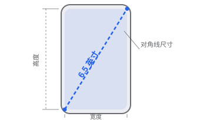

（封面图片来源于「**MORI森**」的插画，非常好看的说！[https://www.pixiv.net/users/14292311](https://www.pixiv.net/users/14292311)）

本文所述的「大前端」便主要覆盖了：Web、Android、iOS、Flutter、RN 等等平台，但目前只更新到了前面一点点，还有非常大量的内容，但是太晚了，先睡了

首先，我们可以把尺寸分成下面几个层级：

1. **物理尺寸**

    屏幕英寸 · 毫米 · PPI · 物理像素

2. **逻辑尺寸**

    CSS px · Android dp · iOS pt · Flutter Logical Pixel · RN DIP

3. **相对尺寸**

    % · em · rem · vw · vh · dvh · cqw

4. 另外还有一些光栅化、字体缩放、像素取整等等的调整

## 物理尺寸

### **物理像素（Physical Pixel）**

这边值得就是屏幕实际的像素。

例如一块分辨率为 1170 × 2532 的屏幕，意味着它在横向有 1170 个物理像素，在纵向有 2532 个物理像素。

### 物理像素密度（PPI, Pixels Per Inch）

表示「**在屏幕上，每英寸物理长度对应多少个物理像素**」

PPI 可以根据屏幕尺寸和分辨率计算：

$$
PPI= \frac{\sqrt{W^2+H^2}}{D}
$$

其中：

- $W$：横向物理像素数
- $H$：纵向物理像素数
- $E$：屏幕对角线英寸数

例如，1080 × 2400 分辨率、6.5 英寸的手机，其计算得到的像素密度就是 405PPI

我们还可以反过来计算：

$$
\text{物理长度（英寸）}=\frac{\text{物理像素数量}}{PPI}
$$

例如，在这块 405 PPI 的屏幕上，100 个物理像素对应：

$$
\frac{100}{405}\times25.4\approx6.27\text{ mm}
$$

这就建立了**物理像素数量和现实世界长度之间的联系**

## 逻辑尺寸

现在假设我们开发一个按钮，宽度固定为 100 个物理像素。当这个按钮显示在不同像素密度的屏幕上时：

| 屏幕像素密度  | 100 物理像素的实际宽度 |
| ------- | ------------- |
| 200 PPI | 12.70 mm      |
| 300 PPI | 8.47 mm       |
| 400 PPI | 6.35 mm       |
| 500 PPI | 5.08 mm       |

你会发现，随着 PPI 增大，同样数量的物理像素对应的实际长度越来越短。

这意味着：在高密度屏幕上，固定像素数量的按钮会变得更小。

如果所有 UI 都直接使用物理像素定义尺寸，开发者就必须自行适配不同的屏幕密度。

这就是逻辑尺寸出现的根本原因之一：**我们希望用一套相对稳定的坐标和尺寸体系来描述 UI，而不需要每次都直接面对硬件像素**

所以定义了**逻辑尺寸（Logical Size）**

假设有两块尺寸相同、分辨率不同的屏幕：

| 属性     | 屏幕 A   | 屏幕 B   |
| ------ | ------ | ------ |
| 物理宽度   | 约 68mm | 约 68mm |
| 横向物理像素 | 400px  | 800px  |
| 逻辑宽度   | 200 单位 | 200 单位 |
| 映射倍率   | 2×     | 4×     |

所以我们人为地去对着两个分辨率不同的屏幕赋予了一致的逻辑宽度，通过映射倍率来连接，所以在设计的时候只需要使用逻辑单位即可保证同样的逻辑宽度得到一样的元素大小（关于详细说明先放在[显示密度参考基准](https://app.notion.com/p/400960f9382e8042b702ec468f12ac23#400960f9382e805282a9c62e67527db9) 一章中，由于这个章节比较难理解，所以这边单独开一章，如果无法理解参考基准一章也能直接跳过，不会造成非常大的影响）

### 缩放系数（Scale Factor）

在同一个方向上：

$$
\boxed{Scale=\frac{\text{物理像素数量}}{\text{逻辑尺寸数值}}}

$$

所以：

$$

\boxed{\text{物理像素数量}=\text{逻辑尺寸}\times Scale}

$$

反过来：

$$

\boxed{\text{逻辑尺寸}=\frac{\text{物理像素数量}}{Scale}}
$$

例如一块屏幕横向有 1080 个物理像素，系统选择 3 倍缩放：

$$

\frac{1080}{3}=360

$$

意味着这块屏幕的逻辑宽度为 360 个单位。

假设开发者规定按钮宽度为 100 个逻辑单位：

$$
100\times3=300
$$

系统就需要将按钮绘制成约 300 个设备像素宽。

这里存在一个特别重要的区别：

- 物理像素数量由硬件决定。
- 逻辑尺寸由物理像素数量与系统采用的缩放系数共同决定。

---

同时在不同平台使用不同的逻辑尺寸单位

| 平台           | 逻辑尺寸单位        | 映射系数             |
| ------------ | ------------- | ---------------- |
| Android      | dp            | density          |
| iOS          | pt（Point）     | scale            |
| Web          | CSS px        | DPR              |
| Flutter      | Logical Pixel | devicePixelRatio |
| React Native | DIP           | PixelRatio       |

例如：

Android

$$
px=dp\times density
$$

iOS

$$
\text{设备坐标像素数}=pt\times scale
$$

Web

$$

\text{设备像素数}\approx\text{CSS px}\times DPR
$$

这几套公式的思路基本一致，但缩放系数的来源和具体行为不一定相同。比如 Web 的 DPR 可能受浏览器页面缩放影响，而 iOS 的 `scale` 与显示面板的 `nativeScale` 也可能不同。

## 显示密度参考基准

这个概念有点模糊，如果看不懂可以跳过

在前面我给出了一个映射系数（下面讲这个系数都成为 Scale），并且你也可以容易得到：

Scale 的定义式——

$$
\boxed{Scale=\frac{\text{物理像素数量}}{\text{逻辑像素数量}}}
$$

对，这边其实是**定义式**

> 这边复习一下高中物理的基础知识：比如速度=路程/时间，实际上这边是定义式，即速度并不是由路程和时间来决定的，而是由产生速度的对象如汽车自己的性质来决定的。

所以这边也能知道如下的关系：

1. **由系统来决定 Scale （缩放倍率）的策略**

    如：通过某种方式确定逻辑尺寸与物理像素之间的映射比例——比如 Scale = 2

2. **这才根据策略来得到逻辑尺寸**

    如：根据 Scale 得到逻辑尺寸：1080 物理 px ÷ 2 = 540dp

所以这边所说的「**通过某种方式确定逻辑尺寸与物理像素之间的映射比例**」才是我们需要得到的**决定式**，而**定义式的作用是用于确定逻辑尺寸的。**

---

下面就讲讲相关的定义式

一个场景，假设我们要为两个屏幕开发同一个按钮，并且把按钮的长度都写成 100 物理像素：

| 属性          | 屏幕 A    | 屏幕 B    |
| ----------- | ------- | ------- |
| 物理像素密度      | 200 PPI | 400 PPI |
| 100 物理像素的长度 | 12.7 mm | 6.35 mm |

这时候，能很轻松的知道，在不同的 PPI 下，100 物理像素会有不同的长度

假设我们希望有这样一个（逻辑）单位，比如我们定义 u

这个 u 能做到，我将按钮的宽度写为 100u，他们在实际屏幕上的宽度都一致，那我们这个 u 就需要在不同屏幕上有不同的规定：

- 屏幕 A：1u = 1px
- 屏幕 B：1u = 2px

此时就能保证在两个屏幕上，100u 的长度都是 12.7mm

而实际使用的时候，我们只需要知道两个屏幕各自的 Scale：

$$
Scale_A=1,\qquad Scale_B=2
$$

但是，新的问题出现了：

系统为什么给 A 选择 1，给 B 选择 2？以及如果换成第三块 350 PPI 的屏幕又应该是多少？

此时我们便需要提出这样的一个基准，这也是**参考密度**要解决的问题

我们希望系统不用给每块屏幕单独手工指定缩放倍率，而是能够依据某种规则来选择倍率。

一种简单的设计思路是：

> 希望相同的逻辑尺寸，在不同像素密度的屏幕上，具有大致相同的实际物理长度。

为此，我们应该首先定义，1u 这个单位在在现实中应该多长

> 为什么要定义这个？
>
> 可以想象刚刚的那两个屏幕，我需要定义
>
> - 屏幕 A：1u = 1px
> - 屏幕 B：1u = 2px
>
> 那我就需要定义 1u 的实际长度，然后看在这个长度中能容纳多少的像素 px
>
>

例如，我们人为规定：

$$
1u=\frac{1}{200}\text{ 英寸}
$$

也就是约 0.127mm

接下来，看看不同 PPI 的屏幕需要多少像素才能表示这段长度。

我们发现

| 物理密度    | 1u 能容纳的物理像素 | Scale |
| ------- | ----------- | ----- |
| 200 PPI | 1px         | 1     |
| 300 PPI | 1.5px       | 1.5   |
| 400 PPI | 2px         | 2     |
| 500 PPI | 2.5px       | 2.5   |

根据这个表，我们可以轻易写出：

$$
Scale=\frac{PPI}{200}
$$

**此时，这里的 200，就是我们选择的「显示密度参考基准」**

这边的 200 也可以表述为：在 200 PPI 下，1u 能容纳 1 物理像素，回过头去看看 u 在定义的时候的意义，实际上 **u 就是所谓的逻辑像素**

也就是说，200 更可以表述为：**在 200 PPI 下，我们令 1 逻辑像素=1 物理像素**

注意推导过程：

1. 我们先决定 `1u` 应该具有怎样的物理长度。
2. 然后选择 200 PPI 对应 1 倍缩放。
3. 最后由此得到不同 PPI 下的 Scale。

**这也就是 u（逻辑尺寸） 的设计目标：**

- **开发者能够使用 u 定义逻辑尺寸。**
- **系统能够根据屏幕密度，将 u 转换成设备像素。**

所以我们就能根据这个公式去很轻易的得到 Scale（这也就是 Scale 的决定式）

$$
\boxed{Scale=\frac{\text{实际 PPI}}{\text{基准 PPI}}}
$$

此后系统就能能这边的 Scale 很轻松的参与计算：

1. 用户输入 1u 长度
2. 系统根据

    $$
    
    \boxed{\text{物理像素数量}=\text{逻辑尺寸}\times Scale}
    
    $$

    得到物理像素数量应该是 $1u \times 2(Scale) = 2px$

3. 所以实际需要渲染 2px 像素

当然，更不是说一定要让参考状态下 1u = 1px，我们完全可以规定：

1. 在 200 PPI 时：1u=2px
2. 那么在 400 PPI 时，为了保持相同的物理长度：1u=4px

此时也是个逻辑尺寸体系，不过要多一步换算了，如果直接选

$$
1u=1px\quad (\text{参考状态})
$$

那就方便的多：

- 参考密度下，Scale = 1。
- 比参考密度高一倍，Scale = 2。
- 比参考密度高三倍，Scale = 3。

---

当然，这边的 200 PPI 是我模拟的参考基准，当然下面以几个平台来举例说明下，更详细的展示上面的这一过程和独特的平台区别

## 例子：Android 平台

Android 希望定义一个逻辑尺寸单位 `dp`（也就是上面的 u），并选择了 160 DPI 作为基准：、

$$
1dp=1px\quad(\text{在 densityDpi=160 时})
$$

然后用它构建整套显示密度体系：

$$
density=\frac{densityDpi}{160}
$$

（density 就是 Scale，缩放倍率）

当然，还有一个重要区别——

我们的假想模型是：$Scale=\cfrac{\text{真实 PPI}}{\text{参考 PPI}}$

但是，这边变成了新的东西叫做 DPI

这是因为 **Android 将物理密度和用于 UI 的密度分开了，并将用于 UI 的密度用 DPI 开计量**

- 真实物理密度：160 PPI
- Android 使用的显示密度：160 DPI

以及：**Android 并没有规定 系统使用的 DPI 必须永远等于真实 PPI**

相反，它允许系统选择一个不等于物理 PPI 的密度数值，**目的是控制 UI 缩放**

> 对的，这个我们上面的设计思路并没有矛盾，本质目的并没有违背：
> - 开发者能够使用 `dp` 定义逻辑尺寸。
> - 系统能够根据屏幕密度，将 `dp` 转换成设备像素。
>
> 不过确实是会造成同样的 1dp 在不同 DPI 的设备上可能显示不一致的物理长度
>
>

为了区分这两个数值，我们可以把它们命名为：

- `PPI`：真实物理像素密度。
- `densityDpi`：Android 配置的逻辑显示密度。

这就是 `densityDpi` 出现的原因。

附：DPI 的其他含义

DPI：Dots Per Inch，

DPI 表示每英寸有多少个点。

这个概念最早主要用于打印技术。

例如打印机的 600 DPI，表示每英寸可以排列约 600 个打印点。

但后来，DPI 也被广泛用于描述显示器的像素密度。

这是因为在显示领域，人们有时也会将屏幕像素称为 dot（点）。

于是你会看到两种说法：

- 这块屏幕具有 400 PPI。
- 这块屏幕具有 400 DPI。

在一些显示器资料中，它们被用来表达的是同一件事情

但从严格术语来看，描述屏幕物理像素密度时，PPI 更准确

而 Android 这边只是沿用了 DPI 的表示方式

> 具体例子  
> 我们假设有一台手机，其屏幕真实密度为：  
>   
> $$  
> PPI=400  
> $$  
>   
> 这表示实际每英寸有 400 个物理像素。  
>   
> 这时 Android 可以选择：  
>   
> $$  
> densityDpi=320  
> $$  
>   
> 为什么可以选择 320？  
>   
> 因为 Android 想告诉布局系统：  
>   
> > 虽然这块屏幕实际上有 400 PPI，但我希望 UI 按照 320 DPI 这一档逻辑显示密度进行缩放。  
>   
> Android 采用 160 作为基准，因此：  
>   
> $$  
> density=\frac{320}{160}=2  
> $$  
>   
> 这表示：  
>   
> $$  
> 1dp=2px  
> $$  
>   
> 现在假设有个按钮，宽度为 100dp。  
>   
> 那么：  
>   
> $$  
> 100dp\times2=200px  
> $$  
>   
> 按钮使用 200 个物理像素绘制。  
>   
> 但是，它实际有多少毫米宽？  
>   
> 这时候我们才需要用到真实 PPI：  
>   
> $$  
> \frac{200}{400}\times25.4=12.7mm  
> $$  
>   
> 这就把两个参数的职责分开了：  
>   
> - `densityDpi` 决定 Android 按多大比例绘制 UI。  
>   
> - PPI 决定绘制出的物理像素实际占多少毫米。  
>   
> > 附一个公式：

> 好奇怪，既然 densityDpi 又已经是人为规定的了，那为什么不直接规定 Scale（即 density）呢？  
> > 观看本回答可能会比较绕，如果前面没有理解完全，这边先不要看  
>   
> 对，没错，实际上仅使用 `density`（Scale）就足以完成 Android 的缩放，根本不需要额外引入 `densityDpi`。  
>   
> 但是实际使用上，Android 选择了使用 DPI 数值表达显示密度的体系，并围绕它建立了标准密度档位、资源限定符和相关 API  
>   
> 比如  
>   
> | 资源档位    | densityDpi | density |  
> | ------- | ---------- | ------- |  
> | mdpi    | 160        | 1       |  
> | hdpi    | 240        | 1.5     |  
> | xhdpi   | 320        | 2       |  
> | xxhdpi  | 480        | 3       |  
> | xxxhdpi | 640        | 4       |  
>   
> 当 Android 根据当前密度选择 `drawable-xhdpi`、`drawable-xxhdpi` 等资源时，使用的是这套密度档位约定。  
>   
> 但是其实也不是不能直接用 density  
>   
> Android 完全可以设计成只有 Scale，没有 densityDpi，资源选择仍然能够实现。  
>   
> 只能说已经建立起来的 Android 资源体系、API 和密度档位使用了 DPI 这样的表示形式，因此保留 `densityDpi` 有助于保持体系一致。

