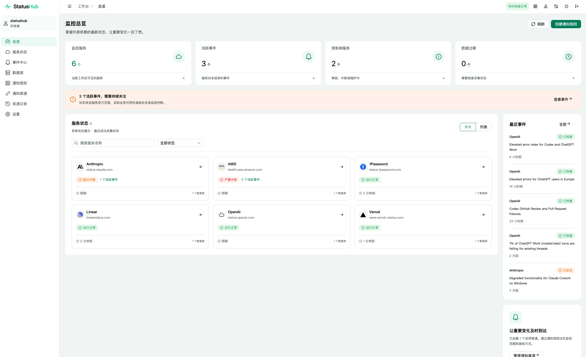
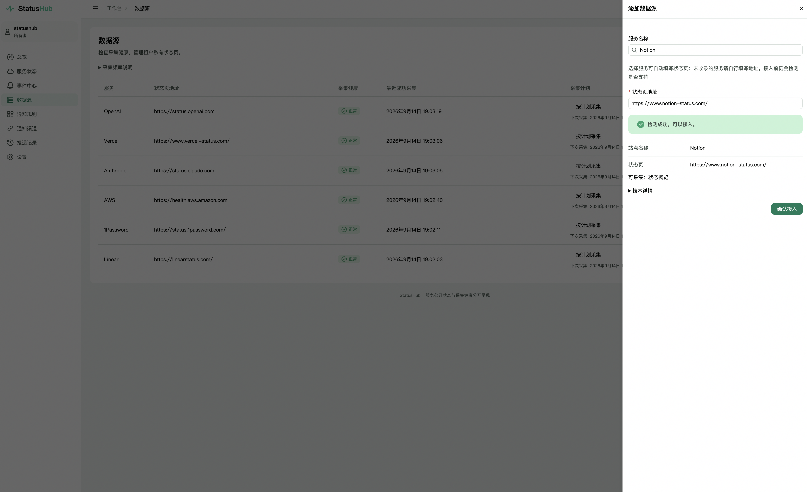
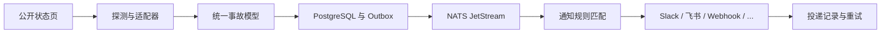
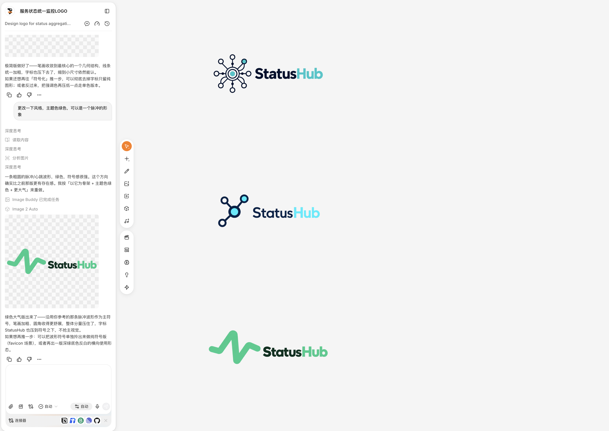
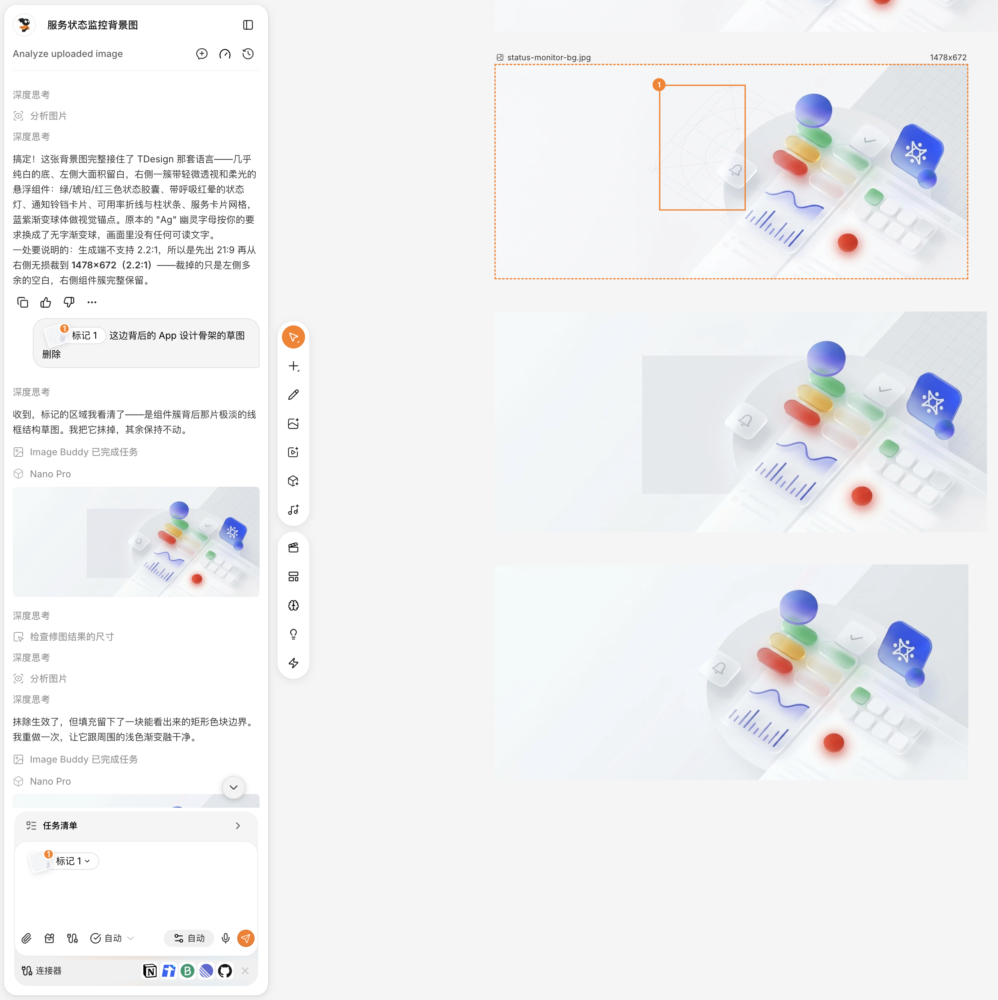
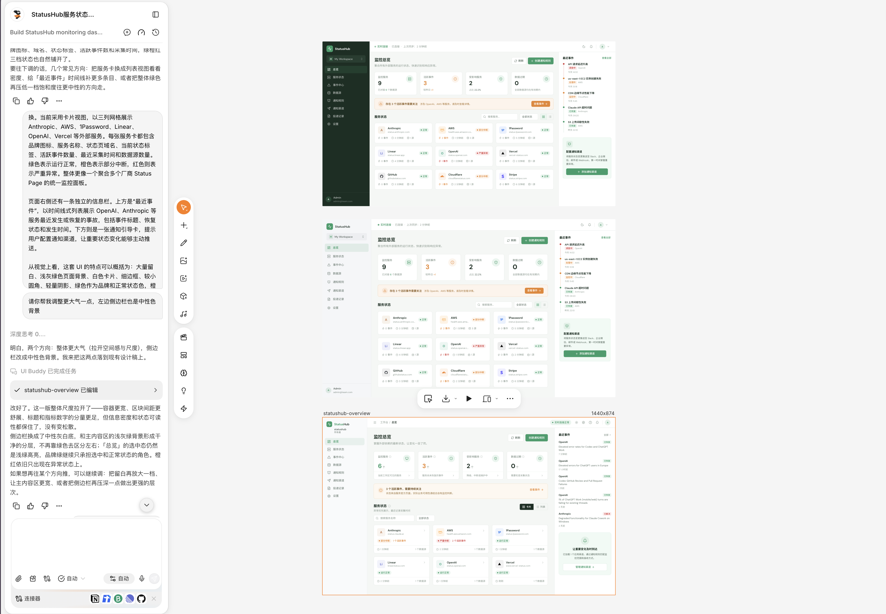
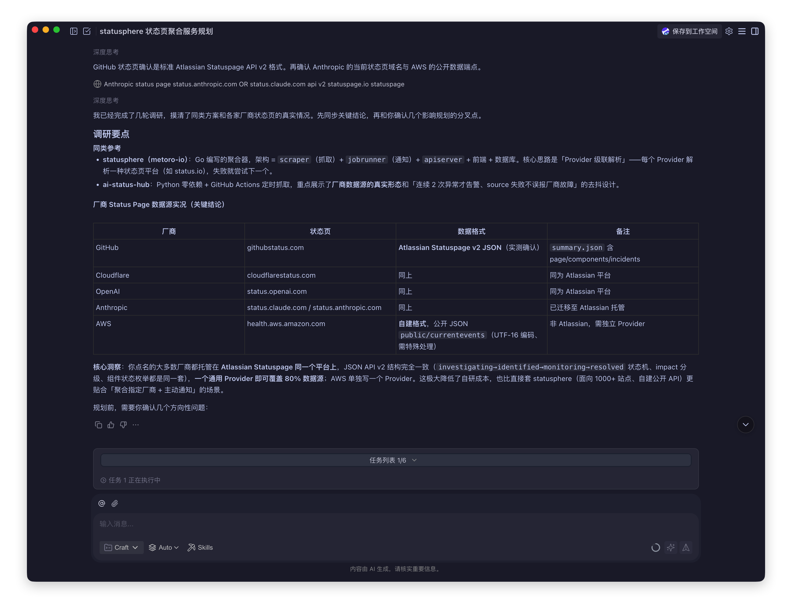
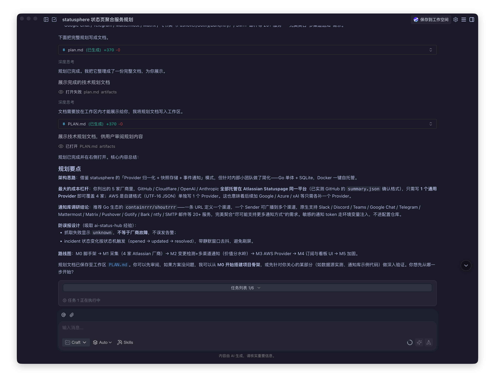
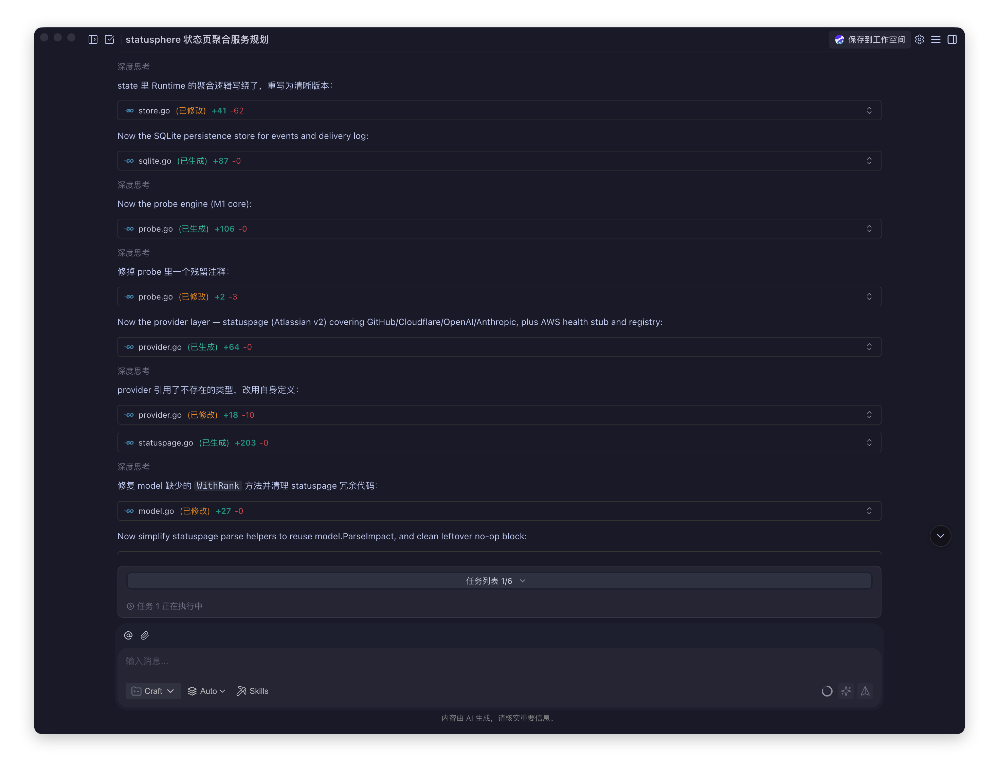

import { LinkPreview } from 'astro-pure/advanced'
import { Aside } from 'astro-pure/user'

import ColorRamp from '../okramp/ColorRamp.astro'

> 犀牛鸟 实战任务 第二任务

犀牛鸟的第二个任务：

> 用 Agent 落地你的产品。使用 TDesign 组件完成一个功能完整的小应用，并使用任务一的色阶生成能力提供主题色切换；使用 Miora 产出 UI 稿与视觉资产，再使用 CodeBuddy 将它开发成真正能够运行、访问和演示的产品。

上一篇文章里，我从一个主色出发，做出了 [OKRamp](/blog/okramp/)；这一次，我想知道它离开色板工作台以后，能不能真的进入一个产品里。

> 其实这边另外可以说的是，在上一个任务的 [OKRamp](/blog/okramp/) 中，其实其 playground 站点本身也是使用 TDesign 组件开发的，符合 TDesign 设计规范的应用。

我选择的是——多服务融合的状态监控和通知系统

项目的在线体验与源码都在这里：

<LinkPreview href='https://statushub.seeridia.top' />

由于为了接入国外服务的状态页，该系统部署在国外服务器上，国内访问可能速度较慢或者同时需要特殊的网络环境。

<LinkPreview href='https://github.com/Seeridia/StatusHub' />

## 背景

现代产品很少只依赖自己的服务器。云平台、代码托管、支付、邮件、AI API 与 CDN，任何一环出问题，最后都可能变成用户眼中的“你的产品坏了”。

这些服务通常都有自己的状态页。问题是，它们散落在不同网站上，也使用不同的结构。真的出现异常时，我需要先猜是哪一家，再逐个打开页面，判断事故是否与自己使用的服务有关，最后把消息转给团队。

如果依赖只有两三家，这还算不上问题；当依赖逐渐变多，它就会变成一种很机械的值班工作。

所以我最初想做的并不是另一个状态页，而是一个**状态页的工作台**：

- 把团队依赖的外部服务放在同一处。
- 把不同来源的事故整理成一致的状态与时间线。
- 只有变化符合规则时，才把消息送到需要知道的人那里。

## 向你介绍 StatusHub

StatusHub 是一个可以自托管的服务状态监控与通知平台。用户输入公开状态页地址，系统识别页面使用的状态引擎，持续采集事故与组件状态，再按照团队配置的规则发送通知。



产品首页优先回答三个问题：

1. 哪些外部依赖正在出问题？
2. 这件事是否可能影响我的团队？
3. 对应的通知有没有成功送达？

围绕这三个问题，工作台形成了总览、服务、事件、通知规则、通知渠道、投递记录与设置七个主要页面。

### 快速添加

我不希望用户在添加服务之前先理解“Statuspage 适配器”或“incident.io Widget API”是什么。

添加数据源时，用户先在 TDesign `SelectInput` 中输入服务名称。选择已经收录的服务，例如 OpenAI，页面会自动补全它的官方状态页地址；目录之外的服务仍然可以输入名称并手动填写 URL。



提交之前，后端会先探测这个地址，返回识别到的适配器与资源能力。

目前 StatusHub 支持 Atlassian Statuspage、incident.io、Instatus、Better Stack、Status.io、Cachet、Gatus、cState、受控 HTML recipe 与 AWS public Health 等来源。这里的重点不是为每一家厂商写一份爬虫，而是识别它们背后共用的状态页引擎。

### 统一事故模型

不同状态页会使用不同字段描述同一件事。StatusHub 在采集后把它们归一为统一的服务、事故、影响等级、阶段与更新时间，再保留上游原文组成时间线。

一条变化进入系统以后，会依次经过这些环节：



这条链路让产品完成了一个真正的闭环：**接入来源 → 发现变化 → 判断是否相关 → 发出通知 → 确认投递结果。**

## 设计 · Miora

状态监控产品天然会出现大量表格、状态标签和数字。如果视觉稿只追求一张漂亮的大屏，真正放入长标题、失败原因和配置表单以后，很容易失去秩序。

所以在 Miora 阶段，我先确定的不是某一张页面，而是一组可以贯穿产品的视觉原则：清晰、克制、适合长时间阅读；状态依靠颜色、图标和文字共同表达；品牌色负责操作与识别，不与红、橙、绿这些业务状态色争夺含义。

同时，我也希望能够快速使用 TDesign 组件完成页面布局，符合 TDesign 的设计规范和交互模式。这样在进入 CodeBuddy 阶段时，Agent 可以直接把视觉稿映射为组件，而不是需要重新设计。

Miora 产出的视觉内容最终落成三类资产：

- **工作台融合稿**：左侧导航、顶部工具栏与内容工作区组成基础框架，总览用指标卡、服务列表和最近事件建立信息层级。
- **登录页视觉**：中央保留产品说明与登录入口，两侧使用立体装饰构成背景，品牌墙展示产品能够连接的服务生态。
- **品牌资产**：StatusHub 的脉冲折线 Logo 与薄荷绿色彩方向。折线同时像监控波形与状态变化，`Hub` 则表达把分散来源汇到一起。

比如，我在 Miora 中设计了他的 LOGO：



比如在登录页中，我让 Miora 模仿 TDesign Starter 的登录页背景，也同样生成了一个立体风格的背景作为登录页。同时 Miora 能很方便的通过标记等等方式去提示 Agent 在对应地方进行修改，大大提高了沟通效率



以及，直接在 Miora 中生成了 StatusHub 的 UI 设计稿：



这份设计稿在下面的 CodeBuddy 阶段被 Agent 直接映射为 TDesign 组件，保留了布局、信息层级、状态标签和交互模式，为后续的开发节省了大量时间。

## 研发 · CodeBuddy

我没有把需求一次性写成“帮我做一个监控后台”。这样的提示或许能很快得到一张可以点击的页面，却很难得到一个能够解释数据、可靠发送通知并持续运行的产品。

在 CodeBuddy 中，这个项目经历了三个很清楚的阶段：**先调研，再 Plan，最后开发**。它们不是三个互不相关的对话，而是一条逐渐收窄问题的路径。调研决定应该解决什么，Plan 决定先验证哪一部分，开发则不断用真实结果修正规划。

### 01 · 调研：先寻找问题的结构

最开始，我只知道自己想把 GitHub、Cloudflare、OpenAI、Anthropic 与 AWS 的状态放在一起。CodeBuddy 没有立刻创建项目，而是先调查了两个方向：有没有相近的开源方案，以及这些厂商究竟怎样提供状态数据。



调研得到的第一个关键发现是：GitHub、Cloudflare、OpenAI 与 Anthropic 虽然属于不同公司，却都使用 Atlassian Statuspage。它们的 `summary.json`、组件和事故接口具有相似结构。与其为四家厂商分别写四份代码，不如先做一个通用的 Statuspage Provider。

AWS 则是一个很有价值的反例。它使用自己的公开数据格式，甚至还需要处理 UTF-16 JSON，不能硬塞进同一个解析器。于是系统从一开始就采用“通用 Provider + 特殊来源独立适配”的结构。

CodeBuddy 还对照了 `statusphere` 与 `ai-status-hub` 等项目。前者证明“采集器、任务调度、API 与通知”可以拆成清楚的职责；后者提醒我必须处理误报：**来源抓取失败只能表示数据未知，不能被解释成厂商故障。**

所以调研并没有直接产出页面，而是先回答了三个会影响整个产品的问题：

- 哪些厂商可以共享一套采集逻辑？
- 哪些来源必须保留自己的适配器？
- 怎样区分厂商异常与 StatusHub 自己没有采集到数据？

这一阶段最大的价值，是把“聚合几个网页”的想法变成了一个可以扩展的数据模型。

### 02 · Plan：把结论变成可以验收的路径

调研完成以后，CodeBuddy 没有把所有功能塞进一次开发，而是先生成一份完整的 `PLAN.md`。里面记录架构选择、风险、数据模型、里程碑与每一阶段的验收条件，再交给我审阅。



初始 Plan 把工作拆成 M0 到 M5：先搭建骨架，再接通四家共用 Statuspage 的厂商；随后完成变化检测和通知；再补 AWS Provider；最后才进入订阅、界面与加固。这个顺序有一个很明确的目的：**先证明最短的数据链路可以跑通，再增加来源、界面和工程复杂度。**

Plan 也提前写出了成本最大的分叉。通用 Provider 能覆盖四个首批来源，AWS 必须单独实现；通知库可以先帮助验证链路，但敏感 Token 不能进入配置仓库；事故只有在状态发生变化时才触发，并且需要去重和静默窗口。

不过，Plan 并不是最终架构的承诺。截图记录的是项目早期版本，当时为了快速验证，方案还是 Go 单体、SQLite 与第三方通知库。随着产品从原型走向可部署版本，SQLite 被 PostgreSQL 取代，进程内链路演进为 Outbox 与 NATS JetStream，通知也变成了可以查看重试与投递结果的独立管线。

我更愿意把 Plan 理解为一张路线图：它让 Agent 和我知道下一步要证明什么，也允许已经被事实推翻的选择被替换。

### 03 · 开发：让每个文件都对应一个可验证结果

进入开发阶段以后，CodeBuddy 按照 Plan 逐项推进。截图里可以看到它先重整运行时状态，再创建持久化层、探测器、Provider 注册表与 Statuspage 实现。每次生成或修改文件后，它会继续处理类型错误、缺失方法与重复逻辑，而不是等所有代码写完后才尝试运行。



CodeBuddy 在这里承担了调研、文件修改、迁移、测试和浏览器回归，但它并没有替我做完产品判断。例如“首次采集不发送历史事故”“通知规则应该选择服务而不是填写 UUID”“服务状态与采集新鲜度必须分开”，都需要我在看到中间结果以后继续修正规则。

开发中也出现过很典型的偏差：页面一度为了贴近视觉稿覆盖了过多 TDesign 样式，组件原本的交互层级与信息密度反而被削弱。之后我让 CodeBuddy 重新以 TDesign Token 和 Starter 规范为边界，保留 Miora 稿中的布局与信息关系，收回多余的局部样式。

这三个阶段真正形成的是一个反馈环：调研减少错误假设，Plan 控制一次开发的范围，开发结果再返回来修正 Plan。Agent 带来的速度，最终需要靠这条反馈环变成可以交付的质量。

## Design Token · OKRamp 色阶生成

这次作业要求复用任务一的色阶能力。我不想在 CSS 里把 Logo 的绿色复制几十次，也不想只覆盖 `--td-brand-color`，让 Hover、禁用态、链接、边框与深色模式仍然留在原来的蓝色体系里。

StatusHub 直接安装了 `@okramp/core` 与 `@okramp/tdesign`。构建前，脚本以 Logo 的薄荷绿 `#20C897` 为输入，同时生成品牌色阶和带有相同冷暖倾向的中性色阶：

<ColorRamp
  title='StatusHub 品牌色阶'
  seed='#20C897'
  colors={[
    '#ebf9f2',
    '#cdf2e2',
    '#a4e5c9',
    '#6fd1ab',
    '#27b98c',
    '#009a73',
    '#007c5b',
    '#005f45',
    '#004330',
    '#00291c'
  ]}
/>

生成结果继续映射为 TDesign 的语义 Token：

```text
浅色：brand-7 → 默认操作色，brand-8 → Hover，brand-9 → Active
深色：brand-5 → 默认操作色，brand-4 → Hover，brand-6 → Active
背景、容器、文字与边框 → 由 14 级关联中性色映射
```

浅色主题需要较深的绿色承载白色按钮文字；深色主题则选择更亮的阶位，保证它在深背景上仍然清楚。`contrastPolicy: "adjust"` 会在色阶中寻找满足目标对比度、又尽量接近原角色的颜色，生成阶段若仍有检查项不通过便直接失败。

最终，Button、Link、Input、Select、Table、Tag、Drawer 与 Dialog 都从同一套 `--td-*` 变量读取颜色。主题切换只改变 `theme-mode`，不需要在运行时重新计算整张色板。圆角也集中映射到 TDesign Token，普通控件从 8px 开始，容器逐级增加，圆形和胶囊形组件仍保留原有形状。

## 交付与验证

StatusHub 当前已经提供可访问的 HTTPS 演示地址和完整源码仓库。

<LinkPreview href='https://statushub.seeridia.top' />

由于为了接入国外服务的状态页，该系统部署在国外服务器上，国内访问可能速度较慢或者同时需要特殊的网络环境。

<LinkPreview href='https://github.com/Seeridia/StatusHub' />

## 结束语

做完 OKRamp 时，我得到的是一个能够解释颜色如何生成的工具；把它放进 StatusHub 以后，我才真正看到一套色阶如何影响按钮、背景、文字、边框、Hover 与深色模式。

而 StatusHub 本身也经历了类似的过程。它最初只是“把几家状态页放在一起”的想法，经过产品边界、视觉系统、组件语义、数据一致性和通知可靠性的反复补全，才成为一个能够接入、判断、通知与追踪的小应用。

Agent 让从想法到运行产品的距离明显缩短了，Miora、CodeBuddy 让这个过程更可控、更可验证。它们的组合，让我在短时间内完成了一个从设计到研发、从视觉到代码、从单一网页到完整产品的闭环。
